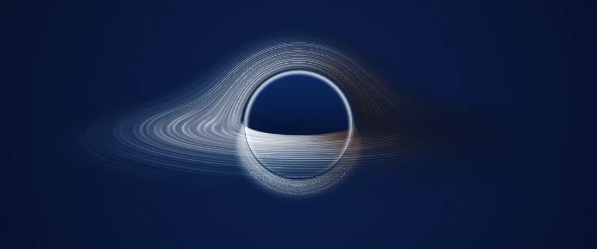
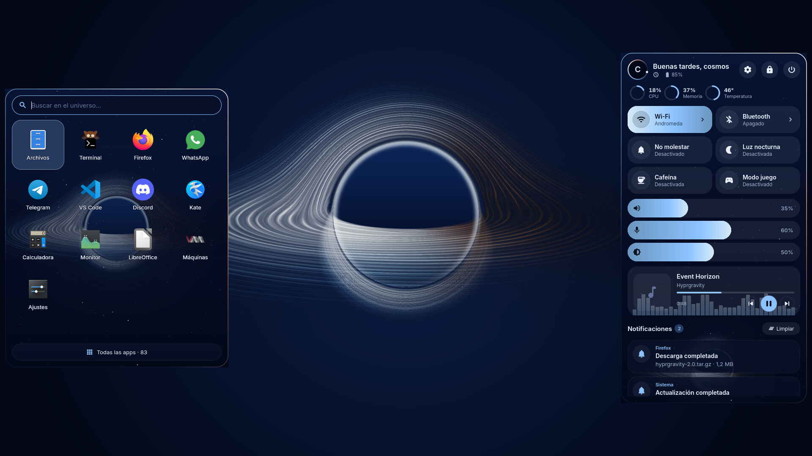
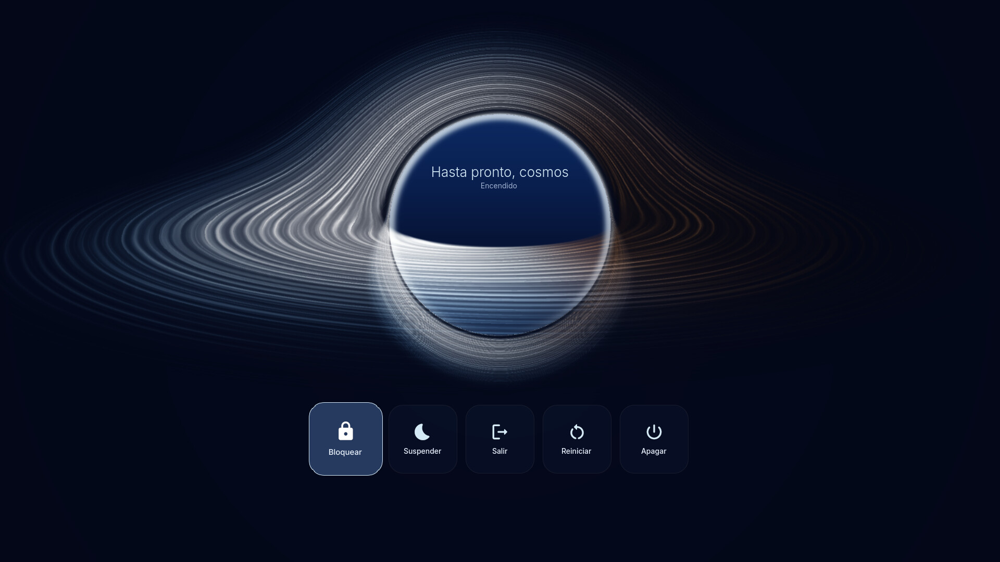
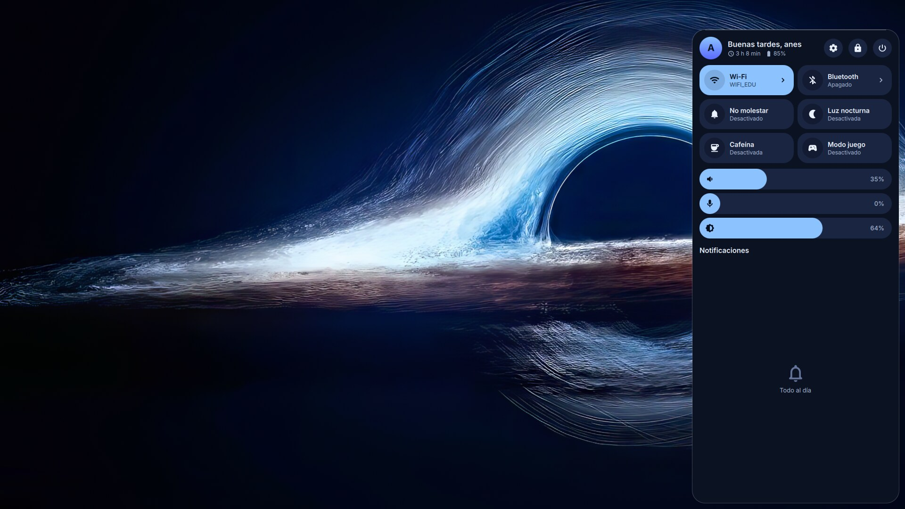
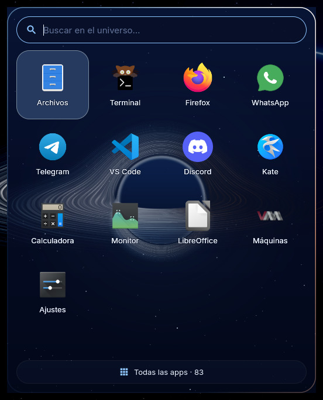
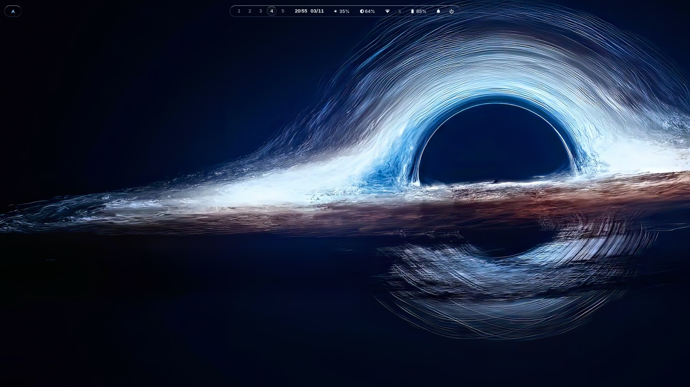
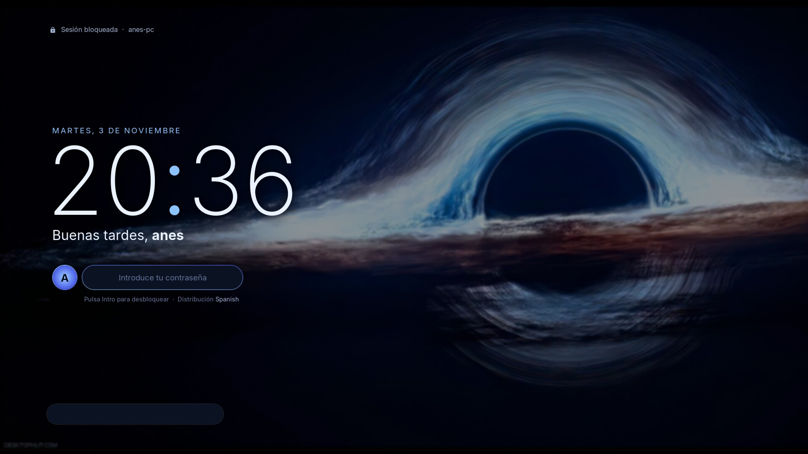

<div align="center">



# ✦ Hyprgravity

**Un agujero negro de verdad en tu Hyprland.**

Luz curvada por la gravedad, calculada en tu GPU. Shell propia, modo oscuro en todo el sistema y un instalador que hace el trabajo por ti.

Hyprland 0.57 · Lua · Quickshell · EndeavourOS, Arch y NixOS

[**Instalar**](#instalación) · [Qué incluye](#qué-incluye) · [Atajos](#atajos-principales) · [Problemas](#si-algo-falla)



</div>

## Capturas

| Menú de apagado |
|---|
|  |

| Panel de control | Lanzador |
|---|---|
|  |  |

| Escritorio | Pantalla de bloqueo |
|---|---|
|  |  |

<sub>La animación y las vistas del panel, el lanzador y el menú de apagado son renders de la interfaz real con datos de ejemplo. El escritorio y la pantalla de bloqueo son capturas de una versión anterior.</sub>

## Qué incluye

- **Barra (waybar) de cristal**: lanzador, escritorios, reloj con calendario del mes, volumen, brillo, Wi-Fi, Bluetooth, USB, batería con tooltip completo y campana de notificaciones.
- **Cosmic Shell (Quickshell)**: centro de control al estilo Material You, con toggles (Wi-Fi, Bluetooth, No molestar, luz nocturna, cafeína, modo juego), páginas de Wi-Fi y Bluetooth para conectarte desde ahí, sliders de volumen, micro y brillo, tarjeta de música con carátula y servidor de notificaciones propio con toasts animados.
- **Pantalla de bloqueo (hyprlock)**: diseño editorial con reloj grande, saludo, avatar, música y barra de estado (red, batería, clima).
- **Agujero negro en la GPU**: cada píxel traza un rayo de luz curvado por la gravedad. Está en el panel, el lanzador y el menú de apagado, y no consume nada con ellos cerrados.
- **Lanzador (Quickshell)**: las apps salen en espiral del agujero negro.
- **Menú de apagado a pantalla completa**, visualizador de audio y anillos de CPU, memoria y temperatura.
- **Modo oscuro en todo el sistema**: GTK, Qt, KDE y Chromium.
- **Menús (rofi)**: Wi-Fi, emojis y chuleta de atajos generada a partir de tu config.
- **OSD (swayosd)** de volumen y brillo.
- **Gestos**: pellizco con 3 dedos = pantalla completa, 3 dedos a los lados = escritorios, 4 dedos = cambiar de ventana.
- **Detalles**: fondo de vídeo que se pausa cuando hay ventanas, luz nocturna, cuentagotas, modo juego, portapapeles, barra que se oculta sola.

## Instalación

### EndeavourOS, Arch y derivadas

Abre una terminal, pega esto y pulsa Enter:

```bash
git clone https://github.com/AnesMx96/cosmic-hyprland.git ~/hyprgravity && ~/hyprgravity/install.sh
```

Solo te hará **una pregunta**, y te pedirá tu contraseña cuando haga falta. Al terminar:

1. Reinicia el ordenador.
2. Al iniciar sesión, elige **Hyprland** en el selector de sesión.
3. Pulsa `SUPER+F1` para ver los atajos. `SUPER` es la tecla de Windows.

Tu escritorio actual no se borra: puedes volver a él eligiéndolo al iniciar sesión.

<details>
<summary>Qué hace exactamente el instalador</summary>

1. Actualiza el sistema e instala las dependencias ([lista](packages/arch.txt)) y `mpvpaper` de AUR. Si no tienes `yay` ni `paru`, instala `yay`.
2. Comprueba que tienes Hyprland 0.57 o superior.
3. **Guarda tu config actual** en `~/.config/hyprgravity-backup-FECHA/`.
4. Copia la config a `~/.config` y genera tu avatar, el fondo de bloqueo y `cfg/local.lua`, con tu distribución de teclado.
5. Pone el modo oscuro en GTK, Qt, KDE y Chromium.
6. Activa NetworkManager, Bluetooth y power-profiles-daemon si hace falta. Si no tienes pantalla de inicio de sesión, instala y activa SDDM.

Opciones: `--yes` (sin preguntas), `--dry-run` (muestra lo que haría sin tocar nada), `--link` (enlaza al repo, así un `git pull` lo actualiza todo), `--no-deps` y `--no-aur`.

</details>

### Si algo falla

- **El instalador se para:** el detalle queda en `~/hyprgravity-install.log`. Puedes volver a lanzar `~/hyprgravity/install.sh` sin riesgo.
- **No aparece el fondo de pantalla:** falta `mpvpaper`. Instálalo con `yay -S mpvpaper`.
- **Quiero volver atrás:** elige tu escritorio anterior al iniciar sesión. Tu config antigua está en `~/.config/hyprgravity-backup-FECHA/`.
- **Máquinas virtuales y Nvidia:** está probado en EndeavourOS con gráficos Intel Iris Xe. En Nvidia no lo he probado, y Hyprland necesita aceleración 3D, así que en una máquina virtual puede no arrancar.

### NixOS (flake + home-manager) · *experimental*

> Los módulos están escritos con los nombres de paquete comprobados en nixpkgs, pero **aún no los he probado en un NixOS real**. Si algo falla, abre un issue.

```nix
# flake.nix de tu sistema
{
  inputs.cosmic.url = "github:AnesMx96/cosmic-hyprland";

  outputs = { nixpkgs, home-manager, cosmic, ... }: {
    nixosConfigurations.mipc = nixpkgs.lib.nixosSystem {
      modules = [
        cosmic.nixosModules.default
        { cosmic.enable = true; }

        home-manager.nixosModules.home-manager
        {
          home-manager.users.tu-usuario = {
            imports = [ cosmic.homeManagerModules.default ];
            cosmic.enable = true;
            # Tus monitores y teclado (opcional):
            cosmic.localConfig = ''
              hl.monitor({ output = "eDP-1", mode = "preferred", position = "auto", scale = 1 })
              hl.config({ input = { kb_layout = "us" } })
            '';
          };
        }
      ];
    };
  };
}
```

Necesita nixpkgs con **Hyprland ≥ 0.57**, porque la config está en Lua (`nixos-unstable`).

### Después de instalar

- **Monitores y teclado** → `~/.config/hypr/cfg/local.lua` (mira `cfg/local.example.lua`). Este archivo no se sube al repo.
- **Fondo animado propio** → copia un vídeo o una imagen a `~/.config/hypr/wallpaper.mp4` (o `.png`/`.jpg`). Si no hay ninguno, se usa el fondo incluido.
- **Avatar y fondo de bloqueo** → `~/.config/hypr/lock-avatar.png` y `~/.config/hypr/lock-bg.png`.

## Atajos principales

`SUPER+F1` muestra todos los atajos.

| Atajo | Acción |
|---|---|
| `SUPER+Enter` | Terminal (kitty) |
| `SUPER+Espacio` / `SUPER+R` | Lanzador en cuadrícula / todas las apps |
| `SUPER+E` | Archivos |
| `SUPER+N` | Centro de control |
| `SUPER+X` | Menú de apagado |
| `SUPER+L` | Bloquear |
| `SUPER+Q` | Cerrar ventana |
| `SUPER+F` / `SUPER+T` | Pantalla completa / flotante |
| `SUPER+1…0` | Escritorios |
| `SUPER+Z` | Scratchpad |
| `ALT+Tab` / `ALT+Shift+Tab` | Ventana siguiente / anterior |
| `SUPER+Shift+S` / `Impr` | Captura de zona |
| `SUPER+Shift+V` | Portapapeles |
| `SUPER+.` | Emojis |
| `SUPER+Shift+N` | Luz nocturna |
| `SUPER+G` | Modo juego |
| `SUPER+Shift+M` | Modo de pantalla (extendido, duplicado…) |

## Estructura

```
config/
  hypr/            Hyprland (hyprland.lua + cfg/*.lua), hyprlock, hypridle, scripts
  cosmic-shell/    Quickshell: panel, lanzador, menú de apagado, notificaciones y shader
  waybar/  rofi/  swayosd/  kitty/
packages/          dependencias para Arch
nix/  flake.nix    módulos de NixOS y home-manager
install.sh         instalador
```

## Estado

- [x] Barra de cristal, centro de control, notificaciones, bloqueo, OSD, gestos
- [x] Instalador para Arch y flake para NixOS
- [x] Lanzador de apps en Quickshell
- [ ] Barra nueva en Quickshell
- [x] Menú de apagado en Quickshell
- [ ] OSD en Quickshell
- [ ] Probar el flake en un NixOS real

## Créditos

Hyprgravity es la versión 2.0 de Cosmic, y por eso algunas carpetas y opciones de Nix siguen llamándose `cosmic`.

Inspirado en [end-4/dots-hyprland](https://github.com/end-4/dots-hyprland), [caelestia](https://github.com/caelestia-dots/shell), [DankMaterialShell](https://github.com/duxlabs-dev/dux-shell) y [HyDE](https://github.com/HyDE-Project/HyDE). No hay código copiado de ellos; la idea fue suya.
El fondo incluido (`config/hypr/assets/cosmic-wallpaper.jpg`) es original y se genera con ImageMagick.

## Licencia

[MIT](LICENSE)
